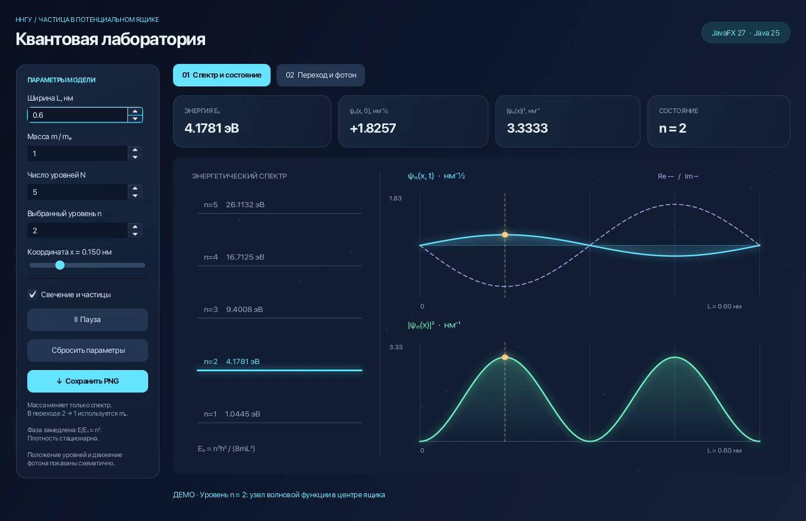
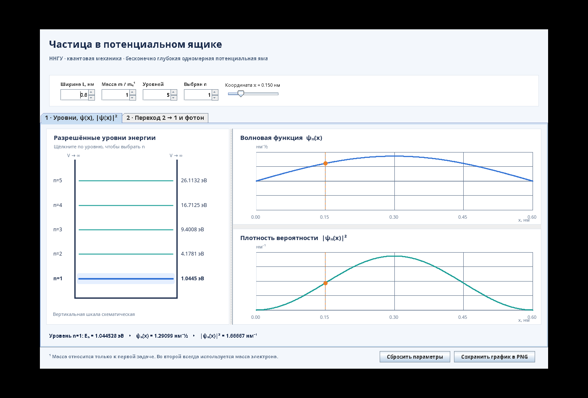
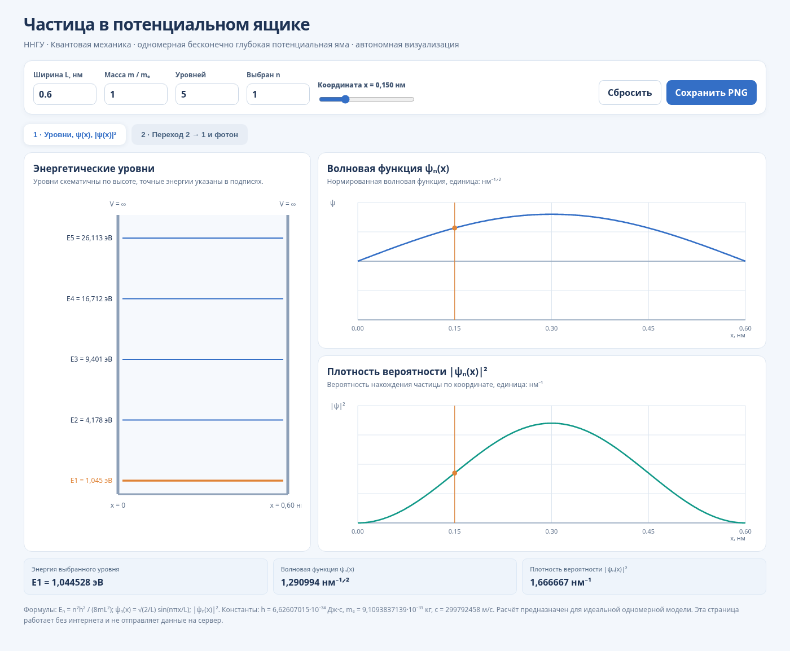
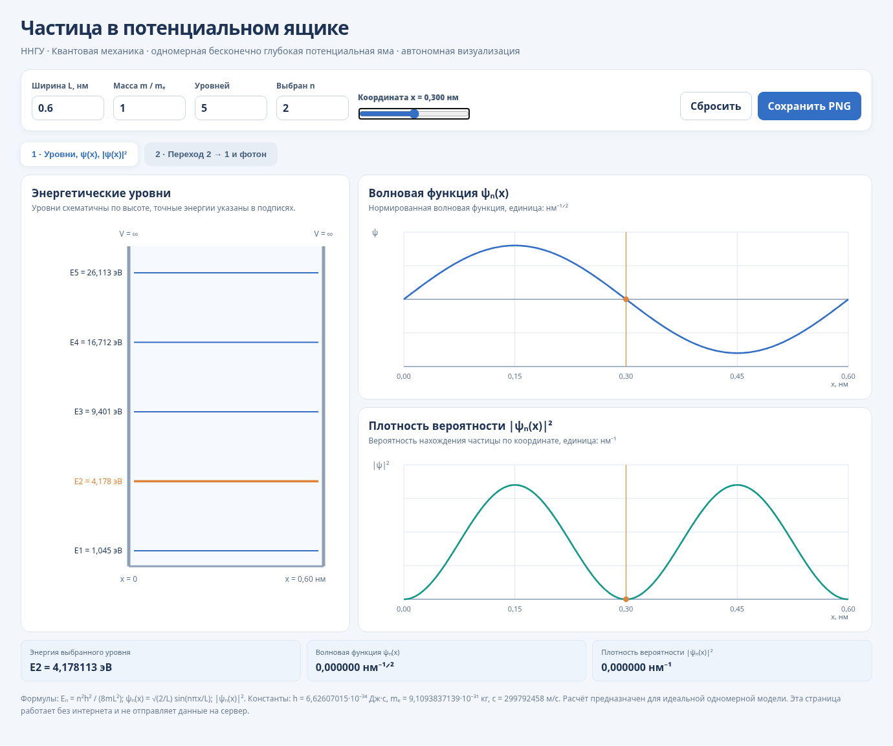
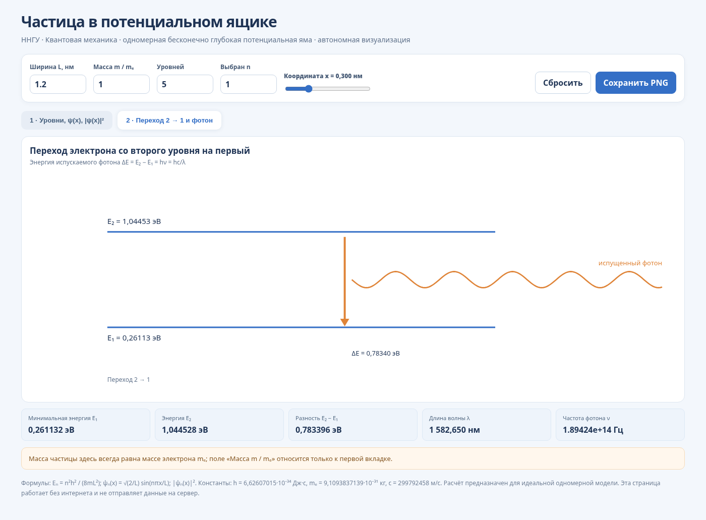
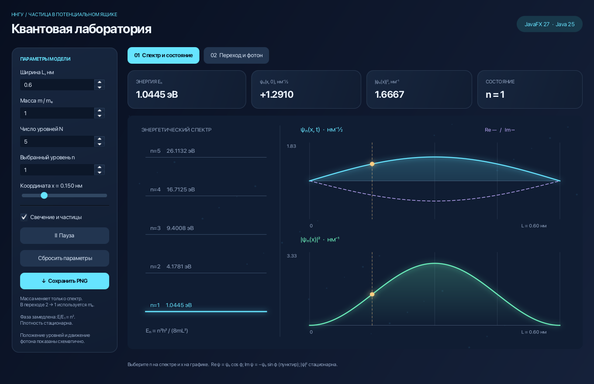
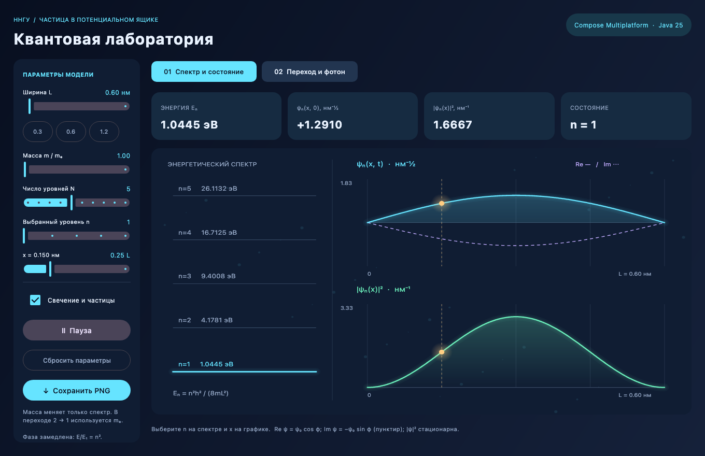
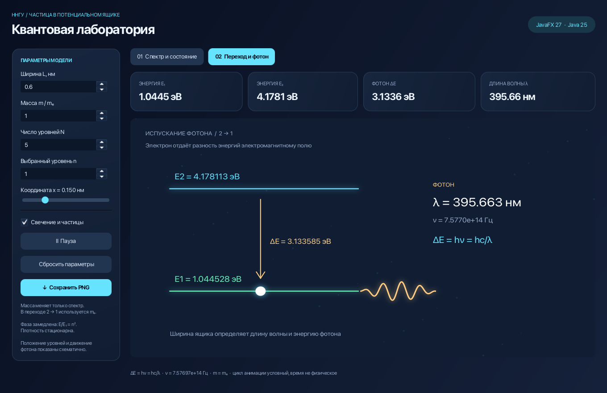

# ННГУ — электрон в потенциальном ящике (Java 25, JavaFX 27, Compose Multiplatform, VB.NET и Python 3)

Учебный проект по двум задачам квантовой механики, реализованным на **Java 25**, **Visual Basic .NET** и **Python 3**.
Исходные реализации используют стандартные библиотеки; для VB.NET требуется .NET SDK. Доступны **три нативных GUI на
Java 25**: Swing, **JavaFX 27.0.1** и **Compose Multiplatform 1.12.2** (Kotlin/JVM). Версии VB.NET/Python открывают общую
автономную интерактивную HTML-страницу с графиками. Для новых GUI Gradle скачивает внешние зависимости.

**Быстрый запуск новых интерфейсов:** `./gradlew :javafx:run` или `./gradlew :compose:run`.
Подготовка, возможности, сборка и экспорт PNG описаны в [разделе 12](#12-javafx-27-и-compose-multiplatform-на-java-25).

**[▶ Демо JavaFX и Compose — 30 секунд, без звука](docs/videos/quantum-well-demo.mp4)**

[](docs/videos/quantum-well-demo.mp4)

## Состав проекта

| Файл                                                | Назначение                                                                                                     |
|-----------------------------------------------------|----------------------------------------------------------------------------------------------------------------|
| `PotentialWellSpectrum.java`                        | Консольная задача: энергии уровней `Eₙ`, волновая функция `ψₙ(x)`, плотность вероятности `                     |ψₙ(x)|²` |
| `ElectronPhotonTransition.java`                     | Консольная задача: переход электрона `n=2 → n=1`, энергия фотона и его длина волны                             |
| `PotentialWellVisualizer.java`                      | Графический интерфейс Swing/Java2D: уровни энергии, графики функций, плотности вероятности и переход электрона |
| `javafx/`                                           | Новый GUI JavaFX 27: Canvas, CSS, анимация фазы, свечение и фотон                                               |
| `compose/`                                          | Новый GUI Compose Multiplatform: Kotlin/JVM, Material 3, Canvas, анимация и экспорт PNG                          |
| `physics/`                                          | Общая модель двух новых GUI, использующая исходные Java-формулы                                               |
| `gradlew`, `gradlew.bat`, `gradle/`                 | Gradle Wrapper 9.6.0: воспроизводимая сборка новых GUI на Java 25                                              |
| `run-javafx-macos.command`, `run-compose-macos.command` | Запуск новых GUI из Finder или терминала                                                                  |
| `QuantumWellSelfTest.java`                          | Проверки формул и результатов без JUnit                                                                        |
| `build-macos.command`                               | **Полная сборка всех исходников, запуск проверок и создание JAR**                                              |
| `run-macos.command`                                 | Запуск готового графического JAR                                                                               |
| `PotentialWellVisualizer.jar`                       | Готовый JAR, если не требуется пересборка                                                                      |
| `preview.png`                                       | Общая демонстрационная схема графиков Java                                                                     |
| `docs/images/`                                      | Иллюстрации Java Swing и веб-интерфейса для README (хранятся в репозитории)                                    |
| `python/`                                           | Python: два консольных расчёта, общая физическая модель, тесты, запуск графиков                                |
| `visual-basic/`                                     | VB.NET: два консольных расчёта, физическая модель, тесты, запуск графиков и .vbproj                            |
| `web/potential-well.html`                           | Общая интерактивная графика на Canvas, открывается без интернета                                               |
| `build-all-macos.command`                           | Проверяет и собирает **все три реализации**                                                                    |
| `run-python-macos.command` и `run-vb-macos.command` | Открывают графики из соответствующей реализации                                                                |

Исходные четыре `.java`-файла в корне находятся в **пакете по умолчанию** и собираются прежним скриптом.
Новые GUI находятся в отдельных Gradle-модулях; копировать их исходники в корень не нужно.

## 1. Как получить проект из GitHub

Склонируйте репозиторий в любой удобный каталог и перейдите в папку проекта:

```bash
git clone URL_РЕПОЗИТОРИЯ nngu
cd nngu
```

Замените `URL_РЕПОЗИТОРИЯ` на HTTPS- или SSH-ссылку из кнопки **Code** на странице репозитория в GitHub. Если проект
скачан кнопкой **Code → Download ZIP**, распакуйте архив и откройте терминал **в корневой папке распакованного
проекта**.

> **Важно:** все дальнейшие команды выполняются **из корня проекта** (там, где находятся `README.md`,
> `build-macos.command` и `.java`-файлы). Все пути к файлам проекта в этой инструкции **относительные**. Проект можно
> разместить в любом каталоге и с любым именем папки.

## 2. Подготовка JDK 25 на macOS

Проверьте, что Java, компилятор и утилита упаковки доступны:

```bash
java -version
javac -version
jar --version
```

Для сборки с Java 25 команда `javac -version` должна показывать `javac 25...`. Если установлено несколько JDK, выберите
нужную версию в текущем окне Терминала:

```bash
export JAVA_HOME=$(/usr/libexec/java_home -v 25)
export PATH="$JAVA_HOME/bin:$PATH"
java -version
javac -version
```

Если команда `/usr/libexec/java_home -v 25` не находит JDK, сначала установите JDK 25. Проверить доступные версии можно
командой `/usr/libexec/java_home -V`.

## 3. Полная сборка одной командой (рекомендуется)

Из корня проекта запустите:

```bash
bash build-macos.command
```

Скрипт последовательно:

1. Проверяет наличие `java`, `javac`, `jar`.
2. Очищает **только** папку `build/classes` и компилирует все **четыре** `.java`-файла.
3. Запускает `QuantumWellSelfTest` и останавливается при ошибке.
4. Создаёт/обновляет `PotentialWellVisualizer.jar` из скомпилированных классов.
5. Проверяет генерацию демонстрационного графика без GUI и сохраняет его в `build/demo.png`.

После успешной сборки:

```bash
java -jar PotentialWellVisualizer.jar
```

Для запуска без JAR:

```bash
java -cp build/classes PotentialWellVisualizer
```

## 4. Полная сборка вручную из исходников

Это те же шаги без скрипта. **Скачанный заранее JAR не нужен.**

### Шаг 1 — чистая компиляция всех классов

```bash
rm -rf build/classes
mkdir -p build/classes
javac -encoding UTF-8 -d build/classes \
  PotentialWellSpectrum.java \
  ElectronPhotonTransition.java \
  PotentialWellVisualizer.java \
  QuantumWellSelfTest.java
```

Скомпилированные `.class`-файлы будут в `build/classes`.

### Шаг 2 — выполнение самопроверок

```bash
java -cp build/classes QuantumWellSelfTest
```

Успешное завершение заканчивается сообщением `Все проверки пройдены.`

### Шаг 3 — запуск приложений непосредственно из исходной сборки

```bash
# Графический интерфейс (оба расчёта)
java -cp build/classes PotentialWellVisualizer

# Первая задача: ширина 0.6 нм, 5 уровней, масса электрона, x=0.15 нм
java -cp build/classes PotentialWellSpectrum 0.6 5 1 0.15

# Вторая задача: электрон в ящике шириной 0.6 нм
java -cp build/classes ElectronPhotonTransition 0.6
```

### Шаг 4 — создание собственного исполняемого JAR

```bash
jar --create --file PotentialWellVisualizer.jar \
  --main-class PotentialWellVisualizer \
  -C build/classes .
```

Созданный JAR содержит **все скомпилированные классы**. Главным классом является `PotentialWellVisualizer`.

```bash
java -jar PotentialWellVisualizer.jar
```

Команда `java -jar` запускает только графическую точку входа. Консольные программы запускайте с `-cp build/classes` (или
с `-cp PotentialWellVisualizer.jar` и именем нужного класса).

### Шаг 5 — генерация PNG из исходной сборки без открытия окна

```bash
java -Djava.awt.headless=true -cp build/classes \
  PotentialWellVisualizer --demo-png build/demo.png
```

После сборки появятся:

```text
nngu/
├── PotentialWellSpectrum.java
├── ElectronPhotonTransition.java
├── PotentialWellVisualizer.java
├── QuantumWellSelfTest.java
├── build-macos.command
├── run-macos.command
├── README.md
├── preview.png
├── PotentialWellVisualizer.jar        # собранный JAR
└── build/
    ├── classes/                     # результаты компиляции
    └── demo.png                     # созданный график
```

## 5. Запуск двумя кликами или через IntelliJ IDEA

Для запуска через Терминал:

```bash
bash run-macos.command
```

Для запуска двойным щелчком в Finder (после распаковки архива) можно сделать скрипты исполняемыми:

```bash
chmod +x build-macos.command run-macos.command
```

В **IntelliJ IDEA** выберите `File → Open`, откройте корневую папку клонированного или распакованного проекта,
установите Project SDK на Java 25. Запускайте `main()` нужного класса: `PotentialWellVisualizer`,
`PotentialWellSpectrum`, `ElectronPhotonTransition` или `QuantumWellSelfTest`.

## 6. Управление графическим интерфейсом

- **Ширина L** — от 0.05 до 10 нм, общая для обеих задач.
- **Масса m/mₑ** — относительная масса частицы для первой вкладки.
- **Уровней** — число отображаемых энергетических уровней от 1 до 10.
- **Выбран n** — уровень, для которого строятся `ψₙ(x)` и `|ψₙ(x)|²`.
- **Координата x** — точка, в которой отображаются значения волновой функции и плотности вероятности.
- **Вторая вкладка** — переход электрона `2 → 1`, энергии `E₁` и `E₂`, разность `ΔE`, частота и длина волны фотона.
- **Сохранить график в PNG** — экспортирует выбранную вкладку в изображение.

Вертикальные положения линий на схеме уровней показаны условно, но подписанные значения энергии рассчитываются по
физическим формулам.

## 7. Физические формулы

Для одномерной бесконечно глубокой потенциальной ямы:

```text
Eₙ      = n²h² / (8mL²)
ψₙ(x)   = √(2/L) · sin(nπx/L),  0 < x < L
ρₙ(x)   = |ψₙ(x)|²
ΔE      = E₂ − E₁ = hν = hc/λ
λ       = hc / ΔE
```

При использовании нанометров для `x` и `L` волновая функция выражается в нм^ (-1/2), а плотность вероятности — в нм^
(-1).

Физические константы: `h = 6.62607015·10⁻³⁴ Дж·с`, `c = 299792458 м/с`, `mₑ = 9.1093837139·10⁻³¹ кг`,
`1 эВ = 1.602176634·10⁻¹⁹ Дж`.

**Проверочный пример:** при `L = 0.6 нм` и `m = mₑ` энергия первого уровня `E₁ ≈ 1.044528 эВ`, второго
`E₂ ≈ 4.178113 эВ`, разность `E₂ − E₁ ≈ 3.133585 эВ`, длина волны фотона `λ ≈ 395.663 нм`.

## 8. Примечания по совместимости

- Для сборки **именно на Java 25** выберите JDK 25 перед запуском `javac` или `build-macos.command`.
- Исходники используют стандартные API и также компилируются на JDK 21; для выпуска JAR, требующего Java 25, собирайте
  их JDK 25.
- JAR не включает саму JVM; на компьютере для запуска нужна установленная Java не старше версии, которой собран JAR (без
  `--release`).
- `Swing` требует графической среды. В безголовом режиме используйте команду `--demo-png`.

---

## 9. Добавлены Visual Basic.NET и Python

Помимо уже существующих программ Java, в проект включены **самостоятельные реализации обеих задач** на VB.NET и Python
3. Формулы, физические константы и единицы измерения согласованы с Java-версией.

**Почему именно VB.NET?** Классический Visual Basic 6 и Windows Forms не запускаются нативно на macOS. Поэтому здесь
выбран **Visual Basic .NET (VB.NET)**: консольные расчёты работают на Mac через .NET SDK, а визуализация открывается в
обычном браузере. Это не проект VB6 и не Windows Forms.

### Структура дополнительных файлов

```text
nngu/
├── *.java                              # исходная Java-версия сохранена
├── build-macos.command                 # прежняя сборка Java
├── build-all-macos.command             # вся Java + Python + VB.NET
├── run-python-macos.command
├── run-vb-macos.command
├── python/
│   ├── physics.py                      # формулы и константы
│   ├── potential_well_spectrum.py      # задача 1
│   ├── electron_photon_transition.py   # задача 2
│   ├── potential_well_visualizer.py    # открытие графического интерфейса
│   └── test_quantum_well.py            # unittest
├── visual-basic/
│   ├── PotentialWellVB.vbproj          # проект .NET (net8.0)
│   ├── Program.vb                      # точка входа
│   ├── Physics.vb                      # формулы и константы
│   ├── PotentialWellSpectrum.vb        # задача 1
│   ├── ElectronPhotonTransition.vb     # задача 2
│   ├── PotentialWellVisualizer.vb      # открытие графического интерфейса
│   └── QuantumWellSelfTest.vb          # встроенные проверки
└── web/
    └── potential-well.html            # автономные интерактивные графики
```

### 9.1. Запуск на Python 3 (macOS)

Понадобится **Python 3.10 или новее**. Проверьте версию:

```bash
python3 --version
```

Два самостоятельных консольных расчёта:

```bash
# Задача 1: L=0.6 нм, 5 уровней, масса электрона, x=0.15 нм
python3 python/potential_well_spectrum.py 0.6 5 1 0.15

# Задача 2: переход электрона 2 -> 1
python3 python/electron_photon_transition.py 0.6
```

Графическая версия и тесты:

```bash
python3 python/potential_well_visualizer.py
python3 -m unittest discover -s python -p 'test_*.py' -v
```

Допускается запуск через `bash run-python-macos.command`. **pip install не нужен:** сторонних Python-зависимостей нет.

### 9.2. Сборка из исходников и запуск на Visual Basic.NET (macOS)

Нужен **.NET SDK 8 или новее** (не только Runtime), установленный для macOS, подходящий к архитектуре Mac (Apple Silicon
или Intel). Проверка:

```bash
dotnet --version
```

Сборка проекта:

```bash
dotnet build visual-basic/PotentialWellVB.vbproj -c Release
```

Запуск первой и второй задач по отдельности:

```bash
dotnet run --project visual-basic -- spectrum 0.6 5 1 0.15
dotnet run --project visual-basic -- transition 0.6
```

Запуск графиков и встроенных тестов:

```bash
dotnet run --project visual-basic -- visualize
dotnet run --project visual-basic -- test
```

Если проект уже собран и не нужно повторно компилировать:

```bash
dotnet run --no-build -c Release --project visual-basic -- test
```

**Где найти исполняемый файл:** после `dotnet build -c Release` результирующие файлы будут в
`visual-basic/bin/Release/net8.0/`. Основной файл запускается кроссплатформенно:

```bash
dotnet visual-basic/bin/Release/net8.0/PotentialWellVB.dll spectrum 0.6 5 1 0.15
```

В отличие от Java-версии здесь нет самостоятельного окна WinForms. Команда `visualize` открывает автономную
HTML-страницу в стандартном браузере. При необходимости можно просто выполнить `open web/potential-well.html`.

### 9.3. Все три варианта: сборка и тесты одной командой

Установите JDK 25, Python 3 и .NET SDK 8+ и выполните:

```bash
bash build-all-macos.command
```

Скрипт пересоберёт Java, проверит физические расчёты на Python, соберёт VB.NET через `dotnet build` и выполнит
самопроверки VB.NET. Если `dotnet` не установлен, Java и Python успеют пройти проверки, после чего скрипт сообщит о
недостающем SDK.

### 9.4. Графики для Visual Basic.NET и Python

Обе реализации открывают один и тот же локальный файл `web/potential-well.html`, который можно запустить **без Python и
без .NET**:

```bash
open web/potential-well.html
```

На странице есть: энергетические уровни, волновая функция, плотность вероятности, переход `2 → 1`, энергия и длина волны
фотона; параметры изменяются интерактивно, а графики сохраняются в PNG. Графический расчёт на странице выполнен обычным
JavaScript, а Python и VB.NET **независимо** считают физические задачи в своих консольных программах.

### 9.5. Контрольный числовой результат во всех трёх языках

При ширине `L = 0.6 нм` и массе электрона:

| Величина |               Значение |
|----------|-----------------------:|
| E₁       |            1.044528 эВ |
| E₂       |            4.178113 эВ |
| E₂ − E₁  |            3.133585 эВ |
| λ фотона | 395.663 нм (округлено) |

**Примечание к проверкам:** скрипты Python и общая HTML-страница проверены в рабочей среде; компиляция VB.NET зависит от
установленного .NET SDK и должна быть дополнительно проверена на вашем Mac, если `dotnet` не установлен в среде сборки.

---

## 10. Примеры графиков и что они показывают

Все изображения ниже сохранены **в самом репозитории** (`docs/images/`), поэтому они отображаются на GitHub
непосредственно в README. Их можно открыть в полном размере по ссылке на соответствующий PNG. Это результаты работы
программ, а не условные художественные иллюстрации.

### 10.1. Окно Java Swing — общая модель



**На рисунке:** электрон заключён между двумя непроницаемыми стенками потенциального ящика шириной **0,6 нм**. Слева
показаны пять разрешённых энергий. Справа синяя линия — волновая функция `ψ₁(x)`, бирюзовая — плотность вероятности
`|ψ₁(x)|²`. Вертикальная оранжевая отметка указывает выбранную координату **x = 0,15 нм**.

**Что происходит:** электрон не может иметь произвольную энергию, а на основном уровне `n = 1` вероятность его
обнаружения максимальна в середине ящика и равна нулю на стенках. В интерфейсе Java можно нажать на другой
энергетический уровень, чтобы сравнить графики.

### 10.2. Основное состояние `n = 1` — графики в браузере (Python / VB.NET)



**Параметры:** ширина `L = 0,6 нм`, масса `m = mₑ`, уровень `n = 1`, координата `x = 0,15 нм`. Энергия **E₁ ≈ 1,045
эВ**.

**Что происходит:** волновая функция имеет одну положительную полуволну без внутренних узлов. Квадрат её модуля
показывает *плотность* вероятности, а не вероятность в одной точке: вероятность найти электрон на небольшом участке
равна площади под зелёным графиком на этом участке. В середине ящика плотность наибольшая.

### 10.3. Возбуждённое состояние `n = 2` — узел в центре



**Параметры:** те же `L = 0,6 нм` и `m = mₑ`, но выбран `n = 2`; оранжевый маркер установлен на **x = 0,30 нм**. Энергия
**E₂ ≈ 4,178 эВ = 4E₁**.

**Что происходит:** синяя волновая функция меняет знак в центре ящика. Это *узел*: `ψ₂(L/2) = 0`, поэтому и плотность
вероятности там равна нулю. Зелёный график имеет два максимума по обе стороны центра. При увеличении номера уровня
появляется больше узлов.

### 10.4. Переход электрона со второго уровня на первый — испускание фотона



**Параметры на этом снимке отличаются от предыдущих:** ширина ящика **L = 1,2 нм**. Видны `E₁ ≈ 0,2611 эВ`,
`E₂ ≈ 1,0445 эВ`, разность **ΔE ≈ 0,7834 эВ** и длина волны **λ ≈ 1582,65 нм**.

**Что происходит:** электрон переходит с более высокого уровня `n = 2` на более низкий `n = 1`. Разность энергий уносит
испущенный фотон: `ΔE = E₂ − E₁ = hν = hc/λ`. Оранжевая стрелка обозначает переход, волнистая линия — фотон. Если
уменьшить ширину ящика до **0,6 нм**, разность энергий возрастёт в четыре раза, а длина волны уменьшится до **≈ 395,66
нм**.

### Как получить собственные картинки

- **Java:** запустите `java -jar PotentialWellVisualizer.jar`, установите параметры и нажмите **«Сохранить график в
  PNG»**. Для автоматического примера без окна:
  `java -Djava.awt.headless=true -cp build/classes PotentialWellVisualizer --demo-png build/demo.png`.
- **Python / VB.NET:** откройте `web/potential-well.html` (или запустите команды `visualize` из разделов 9.1–9.2),
  выберите вкладку и параметры, затем нажмите **«Сохранить PNG»**.

Для добавления нового изображения в README положите PNG в `docs/images/` и используйте относительную ссылку Markdown:
``.

---

## 11. Учебные источники

- Панкратов Е. Л., Булаева Е. А. *Физика*, ННГУ, 2016, пример № 73, стр.
  197–198: https://www.unn.ru/books/met_files/Pankratov_Bulaeva_physics.pdf
- Игнатов С. К. *Задачи по квантовой химии*, ННГУ, 2015, задача №
  3-7: https://www.unn.ru/books/met_files/IgnatovSK-ZadachiQC.pdf

В опубликованных ответах ко второй задаче значение около `4.18 эВ` соответствует `E₂`, а не разности энергий `E₂ − E₁`
(около `3.13 эВ`).

## 12. JavaFX 27 и Compose Multiplatform на Java 25

Это **два дополнительных нативных настольных интерфейса** для тех же двух задач. Swing, консольные программы,
Python, VB.NET и их прежние команды запуска сохранены. Новые приложения используют общую неизменяемую модель
`physics/src/main/java/QuantumWellModel.java` (Java record), которая вызывает формулы исходных Java-классов.

### 12.1. Версии и подготовка

| Компонент | Версия |
|---|---|
| JDK, Java toolchain и целевой байткод Java/Kotlin | **25** |
| JavaFX | **27.0.1** |
| Compose Multiplatform, настольная JVM-цель | **1.12.2** |
| Kotlin Multiplatform и Compose Compiler | **2.4.21** |
| Gradle Wrapper | **9.6.0**, с проверкой SHA-256 дистрибутива |

JavaFX поставляется отдельно от JDK: [JavaFX 27 требует JDK 25 или новее](https://openjfx.io/highlights/27/).
Здесь оба приложения собираются с toolchain 25 и требуют Java 25 для запуска. Kotlin поддерживает целевой
[байткод Java 25 начиная с 2.3.0](https://kotlinlang.org/docs/whatsnew23.html#kotlin-jvm-support-for-java-25).
Preview-функции Java и флаги `--enable-preview` не требуются.

На macOS выберите JDK 25 (установка описана в разделе 2), затем проверьте Wrapper:

```bash
export JAVA_HOME=$(/usr/libexec/java_home -v 25)
export PATH="$JAVA_HOME/bin:$PATH"
java -version
./gradlew --version
```

На Linux задайте `JAVA_HOME` на установленный JDK 25 и используйте те же команды `./gradlew`.
В Windows PowerShell задайте `$env:JAVA_HOME` на каталог JDK 25 и заменяйте `./gradlew` на `./gradlew.bat`.
Первый запуск требует интернета: Wrapper скачает Gradle, затем зависимости из Maven Central/Google Maven.
Устанавливать системный Gradle, Kotlin или JavaFX SDK вручную **не нужно**. После загрузки зависимостей можно
добавить `--offline` к команде Gradle.

Проверенная здесь платформа — **macOS Apple Silicon (arm64), JDK 25.0.1**. Для других ОС нужен JDK соответствующей
архитектуры и доступные нативные библиотеки GUI. JavaFX 27.0.1 публикуется для macOS arm64, Windows x64 и Linux x64;
ограничения Compose приведены в [официальной таблице платформ](https://kotlinlang.org/docs/multiplatform/compose-compatibility-and-versioning.html#supported-platforms).
Это Compose Multiplatform с настроенной **настольной JVM-целью**, без мобильной и браузерной сборок.

### 12.2. Запуск JavaFX 27

Из корня проекта:

```bash
./gradlew :javafx:run

# Сразу открыть переход 2 → 1
./gradlew :javafx:run --args='--transition'
```

На macOS также можно запустить `bash run-javafx-macos.command` или открыть этот файл двойным щелчком в Finder.
JavaFX использует Canvas, CSS-градиенты и тени `DropShadow`; графики перерисовывает `AnimationTimer`.
JavaFX 27 по умолчанию использует Metal на macOS — вручную выбирать графический backend не нужно.



### 12.3. Запуск Compose Multiplatform

```bash
./gradlew :compose:run

# Сразу открыть переход 2 → 1
./gradlew :compose:run --args='--transition'
```

На macOS: `bash run-compose-macos.command` или двойной щелчок по этому файлу в Finder.
Интерфейс написан на Kotlin с Material 3, рисует графики через Compose Canvas/Skia, плавно меняет цвет вкладок
и подсвечивает кривые многослойными штрихами. Изменение времени перерисовывает Canvas без пересоздания контролов.



### 12.4. Управление и визуальные эффекты

В обоих приложениях доступны:

- **Две вкладки:** спектр с волновой функцией и плотностью вероятности; переход электрона `2 → 1` с фотоном.
- **Параметры:** `L = 0.05…10 нм`, `m/mₑ = 0.05…100`, `N = 1…10`, выбранный `n` и координата `x/L = 0…1`.
  При уменьшении N выбранный n автоматически ограничивается новым числом уровней.
- **Прямое управление графиками:** щелчок по спектру выбирает уровень, щелчок или перетаскивание по правым графикам
  меняет координату. Для управления с клавиатуры используйте Tab и стрелки на контролах.
- **Комплексная волновая функция:** бирюзовая линия показывает `Re ψ`, фиолетовый пунктир — `Im ψ`.
  Анимация соответствует `ψ(x,t) = ψ(x,0) exp(−iφ)`, где экранная фаза `φ = n²τ`, а τ — условное замедленное время.
  Зелёная плотность `|ψ|²` **не меняется** у стационарного состояния. Карточка `ψₙ(x,0)` показывает начальную амплитуду.
- **Анимация перехода:** электрон опускается на E₁, затем излучённый волновой пакет фотона уходит вправо.
  Положение уровней, скорость движения и длительность цикла схематичны; числовые энергии, частота и λ рассчитаны.
  Масса во второй задаче всегда равна mₑ, независимо от настройки массы первой задачи.
- **Свечение, градиентные заливки и движущиеся фоновые частицы.** Флажок «Свечение и частицы» отключает эти эффекты;
  «Пауза» отдельно останавливает фазу и переход. «Сбросить параметры» возвращает исходные значения и время.
- **«Сохранить PNG»** сохраняет текущую вкладку и параметры. В JavaFX экспортируется снимок интерфейса;
  Compose повторно рисует тот же UI с зафиксированной фазой в изображение 1360×880.



### 12.5. Сборка, проверки и демонстрационные PNG

```bash
# Сборка обоих GUI и проверка физических расчётов и общей модели
./gradlew build

# Только проверки (без открытия окон)
./gradlew check
```

`physics:check` запускает существующий `QuantumWellSelfTest` и новые проверки общей модели:
граничные параметры, узлы волновой функции, связь νλ = c и независимость энергии фотона от эффективной массы.
Прежний `bash build-macos.command` собирает только исходный Swing/CLI; `bash build-all-macos.command` по-прежнему
проверяет исходные Java, Python и VB.NET. Для JavaFX и Compose используйте Wrapper.

Автоматический экспорт примеров с завершением приложения:

```bash
./gradlew :javafx:run --args='--demo-png build/spectrum.png'
./gradlew :javafx:run --args='--transition --demo-png build/transition.png'

./gradlew :compose:run --args='--demo-png build/spectrum.png'
./gradlew :compose:run --args='--transition --demo-png build/transition.png'
```

Рабочая папка процесса — **каталог соответствующего модуля**, поэтому файлы выше появятся в `javafx/build/`
и `compose/build/`. Можно передать абсолютный путь (путь с пробелами заключите в двойные кавычки внутри `--args`).
JavaFX для этой команды открывает окно и требует графической сессии. Compose использует offscreen-рендер без окна;
для него всё равно нужны нативные библиотеки Skia и системные шрифты. Обычный запуск обоих GUI требует графической среды.

### 12.6. Упаковка и IntelliJ IDEA

Compose может собрать приложение с собственным Java runtime на текущей ОС:

```bash
./gradlew :compose:createDistributable

# Установщик для текущей ОС: DMG на macOS, MSI на Windows, DEB на Linux
./gradlew :compose:packageDistributionForCurrentOS
```

Результаты: `compose/build/compose/binaries/main/app/` и каталоги `dmg/`, `msi/` или `deb/` рядом с ним.
На macOS в `app/` создаётся `QuantumWellCompose.app`; получателю этого приложения отдельно устанавливать Java не нужно.
Упаковка выполняется на целевой ОС, не кросс-компиляцией. Для установщиков могут понадобиться системные средства
упаковки; пример `.app` проверен на macOS arm64.

В **IntelliJ IDEA** откройте корневой `settings.gradle.kts` как Gradle-проект, установите **Gradle JVM = JDK 25**,
дождитесь синхронизации и запустите задачи `javafx → application → run` или `compose → compose desktop → run`.
Системный старый Gradle не используйте: проект настроен на Wrapper.

## 13. Демо-видео без звука

Файл: **[docs/videos/quantum-well-demo.mp4](docs/videos/quantum-well-demo.mp4)**.
Формат — MP4 / H.264, **30 секунд**, 1360×880, 30 кадров/с. Аудиодорожки нет.

Первые 15 секунд показывают **JavaFX 27**, следующие 15 — **Compose Multiplatform**. В каждом интерфейсе показаны
выбор уровней `n = 1 → 2 → 4`, движение координатного маркера, изменение ширины ящика и массы, ограничение n при
уменьшении числа уровней, выключение/включение свечения, пауза, переход `2 → 1`, изменение длины волны фотона и PNG-экспорт.
Подписи внизу кадра объясняют действия.

Видео получено покадровым захватом **самих JavaFX/Compose-интерфейсов** по общему воспроизводимому сценарию
`QuantumWellDemo`, без захвата рабочего стола. Это автоматическая демонстрация: параметры и контролы меняются
программно, диалог выбора PNG заменён сохранением в служебный каталог. Видеоряд содержит реальные графики, расчёты и
анимацию приложений.

### Как перезаписать видео на macOS

Нужны JDK 25 и Xcode Command Line Tools (`xcode-select --install`), графическая сессия для JavaFX и зависимости
Gradle, как в разделе 12. ffmpeg и доступ к микрофону/записи экрана не требуются.

```bash
bash record-demo-macos.command
```

Скрипт захватывает 450 кадров каждого GUI в `build/demo-video/`, кодирует MP4 штатным AVFoundation, проверяет
длительность и отсутствие аудиодорожки, обновляет видео в `docs/videos/` и превью в `docs/images/`.
Промежуточные кадры удаляются только после успешного кодирования; контрольные PNG сохраняются в `build/demo-video/`.

### Размещение на GitHub

Видео и превью включены в файлы проекта, README ссылается на них относительными ссылками. После коммита и push они
доступны в репозитории по ссылке и по нажатию на превью.

Для встроенного плеера загрузите этот же MP4 вложением в GitHub Issue/PR или комментарий: перетащите файл в поле
редактирования и скопируйте полученный URL вложения в отдельный абзац README. Создавать Issue/PR только ради записи
не требуется. Файл меньше 10 МБ; GitHub принимает MP4 и рекомендует H.264 для совместимости браузеров
([официальная инструкция и лимиты](https://docs.github.com/en/get-started/writing-on-github/working-with-advanced-formatting/attaching-files)).

## 14. Windows и Linux

Для общей сборки нужны **JDK 25**, **Python 3.10+**, **.NET SDK 8+** и **Node.js 20+** (для регрессионных проверок
HTML). Зависимости новых GUI скачивает Gradle Wrapper. На Windows команды `python`, `java`, `javac`, `jar`,
`dotnet` и `node` должны быть доступны через PATH; на Linux/macOS для Python используется `python3`.

| Действие | Linux / macOS | Windows cmd / PowerShell |
|---|---|---|
| Собрать и проверить все реализации | `sh build-all.sh` | `.\build-all.bat` |
| Запустить JavaFX | `sh run-javafx.sh` | `.\run-javafx.bat` |
| Запустить Compose | `sh run-compose.sh` | `.\run-compose.bat` |
| Запустить собранный Swing | `java -jar build/legacy/PotentialWellVisualizer.jar` | `java -jar build/legacy/PotentialWellVisualizer.jar` |

Скрипты запуска GUI принимают аргументы Gradle, например `sh run-javafx.sh --args='--transition'`.
Для сборки только новых GUI и общей модели по-прежнему достаточно `./gradlew build` / `.\gradlew.bat build`:
Python, .NET и Node.js этой команде не нужны.

Общая сборка использует `tools/build_all.py`, сохраняет Swing JAR/PNG в `build/legacy/`, проверяет физические
формулы, масштабирование выбора уровней Swing, оба способа запуска Python, синхронизацию HTML-полей и реальные
события мыши Compose. Для отдельной проверки:

```bash
python3 -m python.potential_well_spectrum 0.6 5 1 0.15
python3 -m python.electron_photon_transition 0.6
python3 -m python.potential_well_visualizer --no-open
python3 -m unittest python.test_quantum_well python.test_cli -v
node --test tests/web-ui.test.cjs
./gradlew check
```

Прямой запуск Python-файлов также поддерживается. `python/__init__.py` задаёт пакет, а импорты явно различают
пакетный и файловый запуск, не маскируя ошибки импортируемых модулей.

Проверка HTML выполняется без браузера и проверяет состояние полей и подписей; отрисовку Canvas она не проверяет.
Тест Compose посылает press/move/release в настоящий `ImageComposeScene`, включая клик после перетаскивания.
На Linux тест реальных Swing-контролов можно запустить через виртуальный дисплей:
`xvfb-run -a java -cp build/legacy/classes SwingInteractionSelfTest --gui`.
