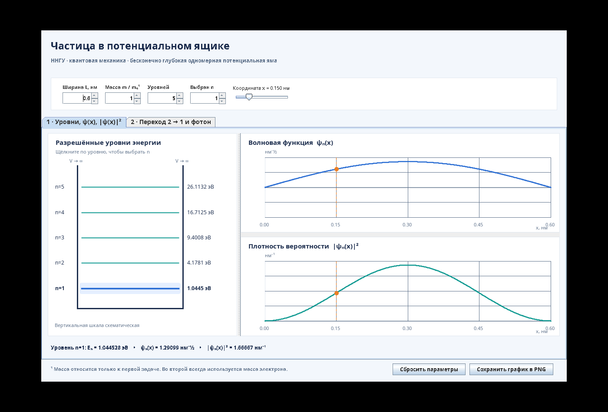
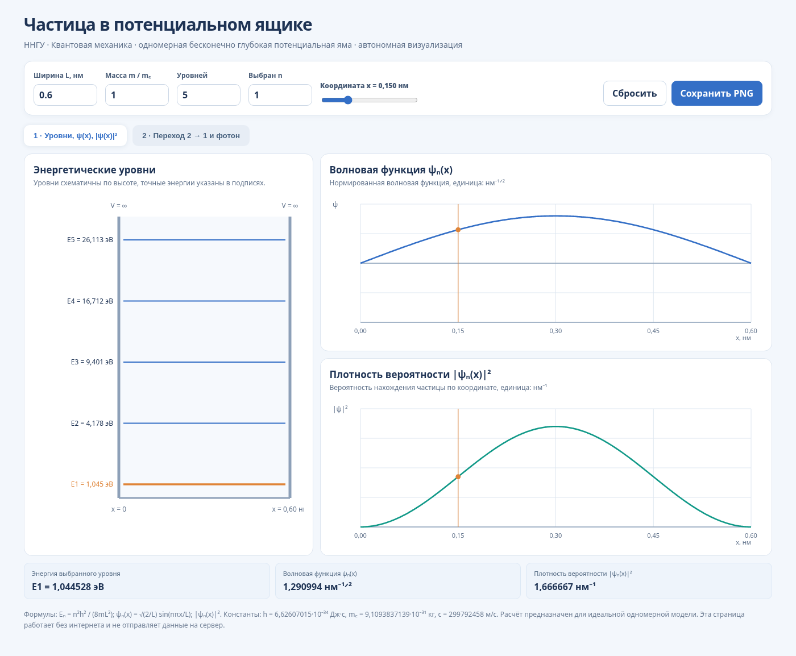
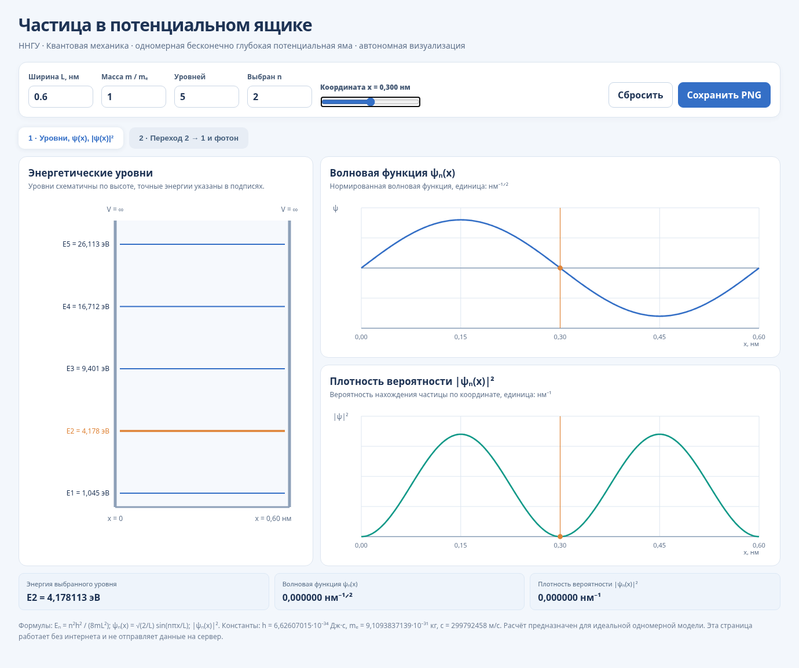
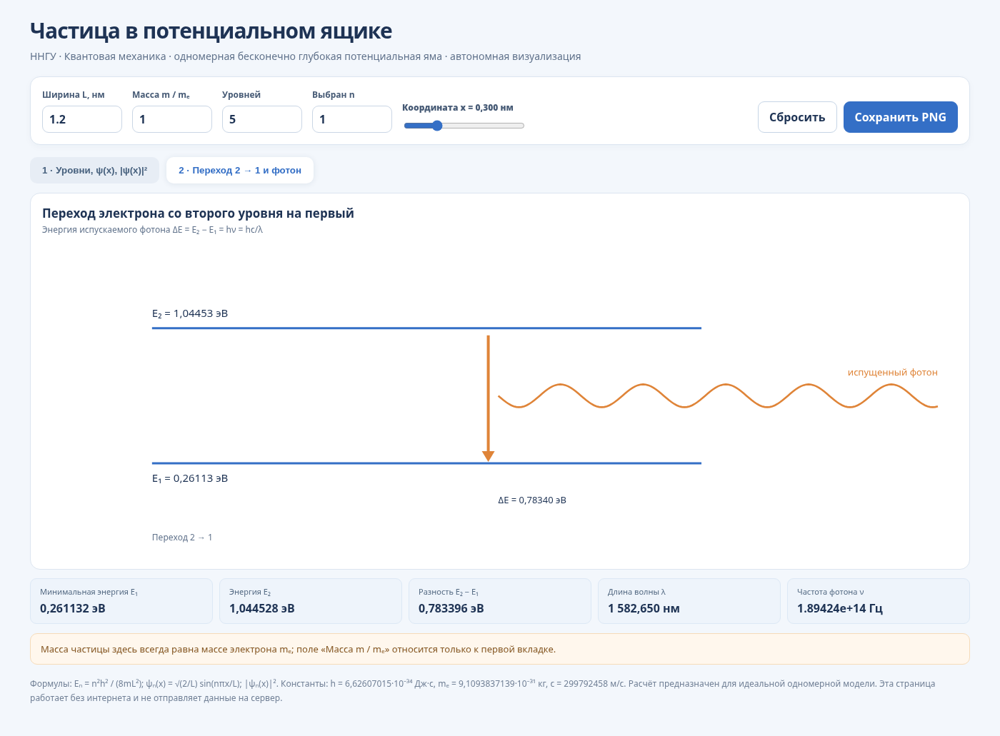

# ННГУ — электрон в потенциальном ящике (Java 25, Visual Basic.NET и Python 3)

Учебный проект по двум задачам квантовой механики, реализованным на **Java 25**, **Visual Basic .NET** и **Python 3**.
Все реализации используют стандартные библиотеки; для VB.NET требуется .NET SDK. Графическая Java-версия построена на
Swing, а версии VB.NET/Python открывают общую автономную интерактивную HTML-страницу с графиками.

## Состав проекта

| Файл                                                | Назначение                                                                                                     |
|-----------------------------------------------------|----------------------------------------------------------------------------------------------------------------|
| `PotentialWellSpectrum.java`                        | Консольная задача: энергии уровней `Eₙ`, волновая функция `ψₙ(x)`, плотность вероятности `                     |ψₙ(x)|²` |
| `ElectronPhotonTransition.java`                     | Консольная задача: переход электрона `n=2 → n=1`, энергия фотона и его длина волны                             |
| `PotentialWellVisualizer.java`                      | Графический интерфейс Swing/Java2D: уровни энергии, графики функций, плотности вероятности и переход электрона |
| `QuantumWellSelfTest.java`                          | Проверки формул и результатов без JUnit                                                                        |
| `build-macos.command`                               | **Полная сборка всех исходников, запуск проверок и создание JAR**                                              |
| `run-macos.command`                                 | Запуск готового графического JAR                                                                               |
| `PotentialWellVisualizer.jar`                       | Готовый JAR, если не требуется пересборка                                                                      |
| `preview.png`                                       | Общая демонстрационная схема графиков Java                                                                     |
| `docs/images/`                                      | Иллюстрации Java Swing и веб-интерфейса для README (хранятся в репозитории)                                    |
| `python/`                                           | Python: два консольных расчёта, общая физическая модель, тесты, запуск графиков                                |
| `visual-basic/`                                     | VB.NET: два консольных расчёта, физическая модель, тесты, запуск графиков и .vbproj                            |
| `web/potential-well.html`                           | Общая интерактивная графика на Canvas, открывается без интернета                                               |
| `build-all-macos.command`                           | Проверяет и собирает **все три реализации**                                                                    |
| `run-python-macos.command` и `run-vb-macos.command` | Открывают графики из соответствующей реализации                                                                |

Все классы находятся в **пакете по умолчанию**, поэтому `.java`-файлы должны лежать в одной папке.

## 1. Как получить проект из GitHub

Склонируйте репозиторий в любой удобный каталог и перейдите в папку проекта:

```bash
git clone URL_РЕПОЗИТОРИЯ nngu
cd nngu
```

Замените `URL_РЕПОЗИТОРИЯ` на HTTPS- или SSH-ссылку из кнопки **Code** на странице репозитория в GitHub. Если проект
скачан кнопкой **Code → Download ZIP**, распакуйте архив и откройте терминал **в корневой папке распакованного
проекта**.

> **Важно:** все дальнейшие команды выполняются **из корня проекта** (там, где находятся `README.md`,
> `build-macos.command` и `.java`-файлы). Все пути к файлам проекта в этой инструкции **относительные**. Проект можно
> разместить в любом каталоге и с любым именем папки.

## 2. Подготовка JDK 25 на macOS

Проверьте, что Java, компилятор и утилита упаковки доступны:

```bash
java -version
javac -version
jar --version
```

Для сборки с Java 25 команда `javac -version` должна показывать `javac 25...`. Если установлено несколько JDK, выберите
нужную версию в текущем окне Терминала:

```bash
export JAVA_HOME=$(/usr/libexec/java_home -v 25)
export PATH="$JAVA_HOME/bin:$PATH"
java -version
javac -version
```

Если команда `/usr/libexec/java_home -v 25` не находит JDK, сначала установите JDK 25. Проверить доступные версии можно
командой `/usr/libexec/java_home -V`.

## 3. Полная сборка одной командой (рекомендуется)

Из корня проекта запустите:

```bash
bash build-macos.command
```

Скрипт последовательно:

1. Проверяет наличие `java`, `javac`, `jar`.
2. Очищает **только** папку `build/classes` и компилирует все **четыре** `.java`-файла.
3. Запускает `QuantumWellSelfTest` и останавливается при ошибке.
4. Создаёт/обновляет `PotentialWellVisualizer.jar` из скомпилированных классов.
5. Проверяет генерацию демонстрационного графика без GUI и сохраняет его в `build/demo.png`.

После успешной сборки:

```bash
java -jar PotentialWellVisualizer.jar
```

Для запуска без JAR:

```bash
java -cp build/classes PotentialWellVisualizer
```

## 4. Полная сборка вручную из исходников

Это те же шаги без скрипта. **Скачанный заранее JAR не нужен.**

### Шаг 1 — чистая компиляция всех классов

```bash
rm -rf build/classes
mkdir -p build/classes
javac -encoding UTF-8 -d build/classes \
  PotentialWellSpectrum.java \
  ElectronPhotonTransition.java \
  PotentialWellVisualizer.java \
  QuantumWellSelfTest.java
```

Скомпилированные `.class`-файлы будут в `build/classes`.

### Шаг 2 — выполнение самопроверок

```bash
java -cp build/classes QuantumWellSelfTest
```

Успешное завершение заканчивается сообщением `Все проверки пройдены.`

### Шаг 3 — запуск приложений непосредственно из исходной сборки

```bash
# Графический интерфейс (оба расчёта)
java -cp build/classes PotentialWellVisualizer

# Первая задача: ширина 0.6 нм, 5 уровней, масса электрона, x=0.15 нм
java -cp build/classes PotentialWellSpectrum 0.6 5 1 0.15

# Вторая задача: электрон в ящике шириной 0.6 нм
java -cp build/classes ElectronPhotonTransition 0.6
```

### Шаг 4 — создание собственного исполняемого JAR

```bash
jar --create --file PotentialWellVisualizer.jar \
  --main-class PotentialWellVisualizer \
  -C build/classes .
```

Созданный JAR содержит **все скомпилированные классы**. Главным классом является `PotentialWellVisualizer`.

```bash
java -jar PotentialWellVisualizer.jar
```

Команда `java -jar` запускает только графическую точку входа. Консольные программы запускайте с `-cp build/classes` (или
с `-cp PotentialWellVisualizer.jar` и именем нужного класса).

### Шаг 5 — генерация PNG из исходной сборки без открытия окна

```bash
java -Djava.awt.headless=true -cp build/classes \
  PotentialWellVisualizer --demo-png build/demo.png
```

После сборки появятся:

```text
nngu/
├── PotentialWellSpectrum.java
├── ElectronPhotonTransition.java
├── PotentialWellVisualizer.java
├── QuantumWellSelfTest.java
├── build-macos.command
├── run-macos.command
├── README.md
├── preview.png
├── PotentialWellVisualizer.jar        # собранный JAR
└── build/
    ├── classes/                     # результаты компиляции
    └── demo.png                     # созданный график
```

## 5. Запуск двумя кликами или через IntelliJ IDEA

Для запуска через Терминал:

```bash
bash run-macos.command
```

Для запуска двойным щелчком в Finder (после распаковки архива) можно сделать скрипты исполняемыми:

```bash
chmod +x build-macos.command run-macos.command
```

В **IntelliJ IDEA** выберите `File → Open`, откройте корневую папку клонированного или распакованного проекта,
установите Project SDK на Java 25. Запускайте `main()` нужного класса: `PotentialWellVisualizer`,
`PotentialWellSpectrum`, `ElectronPhotonTransition` или `QuantumWellSelfTest`.

## 6. Управление графическим интерфейсом

- **Ширина L** — от 0.05 до 10 нм, общая для обеих задач.
- **Масса m/mₑ** — относительная масса частицы для первой вкладки.
- **Уровней** — число отображаемых энергетических уровней от 1 до 10.
- **Выбран n** — уровень, для которого строятся `ψₙ(x)` и `|ψₙ(x)|²`.
- **Координата x** — точка, в которой отображаются значения волновой функции и плотности вероятности.
- **Вторая вкладка** — переход электрона `2 → 1`, энергии `E₁` и `E₂`, разность `ΔE`, частота и длина волны фотона.
- **Сохранить график в PNG** — экспортирует выбранную вкладку в изображение.

Вертикальные положения линий на схеме уровней показаны условно, но подписанные значения энергии рассчитываются по
физическим формулам.

## 7. Физические формулы

Для одномерной бесконечно глубокой потенциальной ямы:

```text
Eₙ      = n²h² / (8mL²)
ψₙ(x)   = √(2/L) · sin(nπx/L),  0 < x < L
ρₙ(x)   = |ψₙ(x)|²
ΔE      = E₂ − E₁ = hν = hc/λ
λ       = hc / ΔE
```

При использовании нанометров для `x` и `L` волновая функция выражается в нм^ (-1/2), а плотность вероятности — в нм^
(-1).

Физические константы: `h = 6.62607015·10⁻³⁴ Дж·с`, `c = 299792458 м/с`, `mₑ = 9.1093837139·10⁻³¹ кг`,
`1 эВ = 1.602176634·10⁻¹⁹ Дж`.

**Проверочный пример:** при `L = 0.6 нм` и `m = mₑ` энергия первого уровня `E₁ ≈ 1.044528 эВ`, второго
`E₂ ≈ 4.178113 эВ`, разность `E₂ − E₁ ≈ 3.133585 эВ`, длина волны фотона `λ ≈ 395.663 нм`.

## 8. Примечания по совместимости

- Для сборки **именно на Java 25** выберите JDK 25 перед запуском `javac` или `build-macos.command`.
- Исходники используют стандартные API и также компилируются на JDK 21; для выпуска JAR, требующего Java 25, собирайте
  их JDK 25.
- JAR не включает саму JVM; на компьютере для запуска нужна установленная Java не старше версии, которой собран JAR (без
  `--release`).
- `Swing` требует графической среды. В безголовом режиме используйте команду `--demo-png`.

---

## 9. Добавлены Visual Basic.NET и Python

Помимо уже существующих программ Java, в проект включены **самостоятельные реализации обеих задач** на VB.NET и Python
3. Формулы, физические константы и единицы измерения согласованы с Java-версией.

**Почему именно VB.NET?** Классический Visual Basic 6 и Windows Forms не запускаются нативно на macOS. Поэтому здесь
выбран **Visual Basic .NET (VB.NET)**: консольные расчёты работают на Mac через .NET SDK, а визуализация открывается в
обычном браузере. Это не проект VB6 и не Windows Forms.

### Структура дополнительных файлов

```text
nngu/
├── *.java                              # исходная Java-версия сохранена
├── build-macos.command                 # прежняя сборка Java
├── build-all-macos.command             # вся Java + Python + VB.NET
├── run-python-macos.command
├── run-vb-macos.command
├── python/
│   ├── physics.py                      # формулы и константы
│   ├── potential_well_spectrum.py      # задача 1
│   ├── electron_photon_transition.py   # задача 2
│   ├── potential_well_visualizer.py    # открытие графического интерфейса
│   └── test_quantum_well.py            # unittest
├── visual-basic/
│   ├── PotentialWellVB.vbproj          # проект .NET (net8.0)
│   ├── Program.vb                      # точка входа
│   ├── Physics.vb                      # формулы и константы
│   ├── PotentialWellSpectrum.vb        # задача 1
│   ├── ElectronPhotonTransition.vb     # задача 2
│   ├── PotentialWellVisualizer.vb      # открытие графического интерфейса
│   └── QuantumWellSelfTest.vb          # встроенные проверки
└── web/
    └── potential-well.html            # автономные интерактивные графики
```

### 9.1. Запуск на Python 3 (macOS)

Понадобится **Python 3.10 или новее**. Проверьте версию:

```bash
python3 --version
```

Два самостоятельных консольных расчёта:

```bash
# Задача 1: L=0.6 нм, 5 уровней, масса электрона, x=0.15 нм
python3 python/potential_well_spectrum.py 0.6 5 1 0.15

# Задача 2: переход электрона 2 -> 1
python3 python/electron_photon_transition.py 0.6
```

Графическая версия и тесты:

```bash
python3 python/potential_well_visualizer.py
python3 -m unittest discover -s python -p 'test_*.py' -v
```

Допускается запуск через `bash run-python-macos.command`. **pip install не нужен:** сторонних Python-зависимостей нет.

### 9.2. Сборка из исходников и запуск на Visual Basic.NET (macOS)

Нужен **.NET SDK 8 или новее** (не только Runtime), установленный для macOS, подходящий к архитектуре Mac (Apple Silicon
или Intel). Проверка:

```bash
dotnet --version
```

Сборка проекта:

```bash
dotnet build visual-basic/PotentialWellVB.vbproj -c Release
```

Запуск первой и второй задач по отдельности:

```bash
dotnet run --project visual-basic -- spectrum 0.6 5 1 0.15
dotnet run --project visual-basic -- transition 0.6
```

Запуск графиков и встроенных тестов:

```bash
dotnet run --project visual-basic -- visualize
dotnet run --project visual-basic -- test
```

Если проект уже собран и не нужно повторно компилировать:

```bash
dotnet run --no-build -c Release --project visual-basic -- test
```

**Где найти исполняемый файл:** после `dotnet build -c Release` результирующие файлы будут в
`visual-basic/bin/Release/net8.0/`. Основной файл запускается кроссплатформенно:

```bash
dotnet visual-basic/bin/Release/net8.0/PotentialWellVB.dll spectrum 0.6 5 1 0.15
```

В отличие от Java-версии здесь нет самостоятельного окна WinForms. Команда `visualize` открывает автономную
HTML-страницу в стандартном браузере. При необходимости можно просто выполнить `open web/potential-well.html`.

### 9.3. Все три варианта: сборка и тесты одной командой

Установите JDK 25, Python 3 и .NET SDK 8+ и выполните:

```bash
bash build-all-macos.command
```

Скрипт пересоберёт Java, проверит физические расчёты на Python, соберёт VB.NET через `dotnet build` и выполнит
самопроверки VB.NET. Если `dotnet` не установлен, Java и Python успеют пройти проверки, после чего скрипт сообщит о
недостающем SDK.

### 9.4. Графики для Visual Basic.NET и Python

Обе реализации открывают один и тот же локальный файл `web/potential-well.html`, который можно запустить **без Python и
без .NET**:

```bash
open web/potential-well.html
```

На странице есть: энергетические уровни, волновая функция, плотность вероятности, переход `2 → 1`, энергия и длина волны
фотона; параметры изменяются интерактивно, а графики сохраняются в PNG. Графический расчёт на странице выполнен обычным
JavaScript, а Python и VB.NET **независимо** считают физические задачи в своих консольных программах.

### 9.5. Контрольный числовой результат во всех трёх языках

При ширине `L = 0.6 нм` и массе электрона:

| Величина |               Значение |
|----------|-----------------------:|
| E₁       |            1.044528 эВ |
| E₂       |            4.178113 эВ |
| E₂ − E₁  |            3.133585 эВ |
| λ фотона | 395.663 нм (округлено) |

**Примечание к проверкам:** скрипты Python и общая HTML-страница проверены в рабочей среде; компиляция VB.NET зависит от
установленного .NET SDK и должна быть дополнительно проверена на вашем Mac, если `dotnet` не установлен в среде сборки.

---

## 10. Примеры графиков и что они показывают

Все изображения ниже сохранены **в самом репозитории** (`docs/images/`), поэтому они отображаются на GitHub
непосредственно в README. Их можно открыть в полном размере по ссылке на соответствующий PNG. Это результаты работы
программ, а не условные художественные иллюстрации.

### 10.1. Окно Java Swing — общая модель



**На рисунке:** электрон заключён между двумя непроницаемыми стенками потенциального ящика шириной **0,6 нм**. Слева
показаны пять разрешённых энергий. Справа синяя линия — волновая функция `ψ₁(x)`, бирюзовая — плотность вероятности
`|ψ₁(x)|²`. Вертикальная оранжевая отметка указывает выбранную координату **x = 0,15 нм**.

**Что происходит:** электрон не может иметь произвольную энергию, а на основном уровне `n = 1` вероятность его
обнаружения максимальна в середине ящика и равна нулю на стенках. В интерфейсе Java можно нажать на другой
энергетический уровень, чтобы сравнить графики.

### 10.2. Основное состояние `n = 1` — графики в браузере (Python / VB.NET)



**Параметры:** ширина `L = 0,6 нм`, масса `m = mₑ`, уровень `n = 1`, координата `x = 0,15 нм`. Энергия **E₁ ≈ 1,045
эВ**.

**Что происходит:** волновая функция имеет одну положительную полуволну без внутренних узлов. Квадрат её модуля
показывает *плотность* вероятности, а не вероятность в одной точке: вероятность найти электрон на небольшом участке
равна площади под зелёным графиком на этом участке. В середине ящика плотность наибольшая.

### 10.3. Возбуждённое состояние `n = 2` — узел в центре



**Параметры:** те же `L = 0,6 нм` и `m = mₑ`, но выбран `n = 2`; оранжевый маркер установлен на **x = 0,30 нм**. Энергия
**E₂ ≈ 4,178 эВ = 4E₁**.

**Что происходит:** синяя волновая функция меняет знак в центре ящика. Это *узел*: `ψ₂(L/2) = 0`, поэтому и плотность
вероятности там равна нулю. Зелёный график имеет два максимума по обе стороны центра. При увеличении номера уровня
появляется больше узлов.

### 10.4. Переход электрона со второго уровня на первый — испускание фотона



**Параметры на этом снимке отличаются от предыдущих:** ширина ящика **L = 1,2 нм**. Видны `E₁ ≈ 0,2611 эВ`,
`E₂ ≈ 1,0445 эВ`, разность **ΔE ≈ 0,7834 эВ** и длина волны **λ ≈ 1582,65 нм**.

**Что происходит:** электрон переходит с более высокого уровня `n = 2` на более низкий `n = 1`. Разность энергий уносит
испущенный фотон: `ΔE = E₂ − E₁ = hν = hc/λ`. Оранжевая стрелка обозначает переход, волнистая линия — фотон. Если
уменьшить ширину ящика до **0,6 нм**, разность энергий возрастёт в четыре раза, а длина волны уменьшится до **≈ 395,66
нм**.

### Как получить собственные картинки

- **Java:** запустите `java -jar PotentialWellVisualizer.jar`, установите параметры и нажмите **«Сохранить график в
  PNG»**. Для автоматического примера без окна:
  `java -Djava.awt.headless=true -cp build/classes PotentialWellVisualizer --demo-png build/demo.png`.
- **Python / VB.NET:** откройте `web/potential-well.html` (или запустите команды `visualize` из разделов 9.1–9.2),
  выберите вкладку и параметры, затем нажмите **«Сохранить PNG»**.

Для добавления нового изображения в README положите PNG в `docs/images/` и используйте относительную ссылку Markdown:
``.

---

## 11. Учебные источники

- Панкратов Е. Л., Булаева Е. А. *Физика*, ННГУ, 2016, пример № 73, стр.
  197–198: https://www.unn.ru/books/met_files/Pankratov_Bulaeva_physics.pdf
- Игнатов С. К. *Задачи по квантовой химии*, ННГУ, 2015, задача №
  3-7: https://www.unn.ru/books/met_files/IgnatovSK-ZadachiQC.pdf

В опубликованных ответах ко второй задаче значение около `4.18 эВ` соответствует `E₂`, а не разности энергий `E₂ − E₁`
(около `3.13 эВ`).
